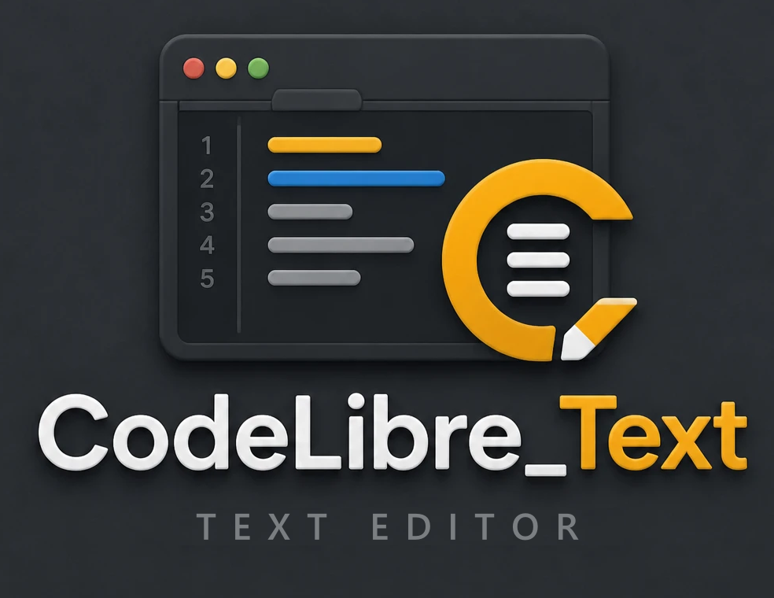

<p align="center">
  
</p>

<p align="center">
  A lightweight, native, open-source text editor written in Rust,
  compatible with Sublime Text packages.
</p>

<p align="center">
  <a href="LICENSE"></a>
  
  
  <a href="https://github.com/oscarchacon/codelibre_text/issues"></a>
</p>

---

> **Work in progress.** CodeLibre Text is usable for everyday editing, but it is still in early
> development (version 0.1). New features land continuously while the editor is available, so expect
> frequent changes. See the [Roadmap](#roadmap) for what is coming next, and
> [Feedback](#feedback--bug-reports) for how to tell us what you need.

## Why CodeLibre Text?

- **Native and fast**: a single binary built with [egui/eframe](https://github.com/emilk/egui), no Electron.
- **Sublime Text compatible**: reads the same packages — syntaxes, color schemes, key bindings, menus,
  command palette entries, settings and (simple) Python plugins.
- **Free software**: MIT licensed, no account, no telemetry.

## Features

### Editing
- Undo/redo, clipboard (including whole-line copy/cut/paste with an empty selection), mouse selection and IME
- Syntax highlighting with [syntect](https://github.com/trishume/syntect) (Sublime's `.sublime-syntax` engine),
  re-highlighted incrementally per line
- Auto indent, Tab/Shift+Tab indent, `translate_tabs_to_spaces`, rulers, word wrap
- Line commands: duplicate, swap up/down, delete, join, add line before/after, toggle comment,
  case conversion, sort/unique/reverse lines, trim trailing whitespace, tabs <-> spaces
- Expand selection (to line, word, brackets, indentation, smart)
- Find & replace panel: regex, case sensitive, whole word, wrap, match highlighting
- Multiple selections: `Ctrl+D`, `Alt+F3` (find all), `Ctrl+Alt+Up/Down` (add line), `Ctrl+Shift+L`
  (split into lines). Typing, Backspace/Delete, Enter, Tab, paste and Left/Right/Home/End act on every
  selection; `Escape` goes back to one
- Files: UTF-8 (with/without BOM) and Latin-1, CRLF/LF preserved, reload on external changes
- Hot exit: open folders and unsaved buffers are restored on the next start

### User interface (Sublime-style)
- Menu bar, tabs, side bar with OPEN FILES and a lazily loaded FOLDERS tree
- Command Palette (`Ctrl+Shift+P`), Goto Anything (`Ctrl+P`, with `:line` and `@symbol`)
- Status bar: caret position, indentation, line endings, encoding, syntax picker
- Console (`` Ctrl+` ``) for plugin output and errors
- Window chrome colors adapt to the active color scheme

### Languages
Unlike Sublime Text, the interface can be shown in several languages. It follows the operating
system by default, and **Preferences > Language…** changes it. The editor ships with:

| Language | Code |
|----------|------|
| English | `en` |
| Deutsch | `de` |
| Español | `es` |
| Français | `fr` |
| Português (Brasil) | `pt_BR` |

Translations are standard gettext `.po` files, and packages can add more languages. Command
names, settings and key bindings stay the same in every language, so Sublime packages keep
working, and the Command Palette also matches what you type in English. Your language is
missing or a text sounds wrong? See [Translating CodeLibre Text](docs/translating.md).

### Sublime Text compatibility
Resources are loaded from `Packages/<Package>/` in Sublime's order (`Default`, other packages,
`User` last). Packages live in `%APPDATA%\codelibre_text\data\Packages` (Windows); if Sublime Text
is installed, its `Packages` folder is read as well (`"import_sublime_packages": false` disables it).

| Resource | Support |
|----------|---------|
| `.sublime-syntax` | Yes (via syntect; some Sublime Text 4-only features may fail, see Help > Package Load Errors) |
| `.tmTheme`, `.sublime-color-scheme` | Yes (`variables`, `globals`, `rules`, `color(... alpha())`) |
| `.sublime-settings` | Yes, layered: defaults -> packages -> `User`, plus per-syntax files |
| `.sublime-keymap` | Yes: chords, args, and `overlay_visible`/`panel_visible`/`setting.*`/`selection_empty`/`num_selections` contexts |
| `Main.sublime-menu` | Yes, merged by `id` |
| `.sublime-commands` | Yes |
| Sublime command names | Built-in subset (`save`, `show_overlay`, `toggle_comment`, `run_macro_file`, `open_url`, …) |
| Python plugins (`.py`) | Partial: `TextCommand`, `WindowCommand` and `ApplicationCommand` run in a separate plugin host (needs Python 3). Event listeners, timers, quick / input panels, dialogs, resources, output panels, statuses and regions work; Package Control does not yet — see [docs/plugins.md](docs/plugins.md) |
| Build systems (`.sublime-build`) | `build`, `exec`, variants, `cancel_build`, results (`next_result`) work from unpacked packages |
| `.sublime-package` archives | Not yet: only unpacked package folders are read |

### Keyboard shortcuts (Sublime Text defaults)
| Shortcut | Action |
|----------|--------|
| Ctrl+N / Ctrl+O / Ctrl+K, Ctrl+O | New file / Open file / Open folder |
| Ctrl+S / Ctrl+Shift+S | Save / Save as |
| Ctrl+W / Ctrl+Shift+T | Close / Reopen closed file |
| Ctrl+Shift+P | Command Palette |
| Ctrl+P / Ctrl+G / Ctrl+R | Goto Anything / Line / Symbol |
| Ctrl+F / Ctrl+H / F3 / Shift+F3 | Find / Replace / Next / Previous |
| Ctrl+D / Alt+F3 / Ctrl+F3 | Add next occurrence / Select all occurrences / Quick find |
| Ctrl+Alt+Up / Down, Ctrl+Shift+L | Add a selection on the line above / below, Split selection into lines |
| Escape | Back to a single selection |
| Ctrl+/ / Ctrl+Shift+/ | Toggle line / block comment |
| Ctrl+Shift+D / Ctrl+Shift+K | Duplicate / Delete line |
| Ctrl+Shift+Up / Down | Swap line up / down |
| Ctrl+L / Ctrl+J | Expand selection to line / Join lines |
| Ctrl+] / Ctrl+[ | Indent / Unindent |
| Ctrl+K, Ctrl+U / Ctrl+K, Ctrl+L | Upper / lower case |
| Ctrl+K, Ctrl+B | Toggle side bar |
| Ctrl+` | Toggle console |
| Alt+1..9, Ctrl+PageUp/PageDown, Ctrl+Tab | Switch tabs |
| Ctrl+= / Ctrl+- / Ctrl+0 | Font size |
| F11 | Full screen |

Override them in Preferences > Key Bindings, exactly like in Sublime Text.

## Getting started

Requires a recent stable Rust toolchain (edition 2021). Python 3 is optional (only for plugins).

```bash
git clone https://github.com/oscarchacon/codelibre_text.git
```

```bash
cargo build --release
```

```bash
cargo run --release -- path/to/folder path/to/file.rs
```

```bash
cargo test --workspace
```

### Graphics requirements

The window is drawn with [wgpu](https://wgpu.rs/), which uses Vulkan or DirectX 12 on Windows,
Vulkan on Linux and Metal on macOS, with OpenGL as its last option. If wgpu cannot start (old GPUs
or drivers, virtual machines, remote desktops), the editor automatically opens again with its
OpenGL renderer (glow, OpenGL 2.1 or newer), so it runs on modest hardware too.

The `WGPU_BACKEND` environment variable chooses the renderer:

| Value | Renderer |
|-------|----------|
| *(unset)* | wgpu, with the automatic OpenGL fallback |
| `glow` | OpenGL renderer directly (skips wgpu) |
| `vulkan`, `dx12`, `metal`, `gl` | wgpu restricted to that API (comma-separated lists work too) |

```bash
WGPU_BACKEND=glow codelibre_text
```

On Windows (PowerShell): `$env:WGPU_BACKEND = "glow"; .\codelibre_text.exe`.

## Installing

The icon lives in `assets/icons/`. The window and taskbar use it on every platform; each system
also needs it where it shows installed applications:

- **Windows**: `cargo build --release` embeds it in `codelibre_text.exe` (`crates/frameworks/build.rs`).
- **Linux**: `packaging/linux/install.sh` installs the binary, the icon and a `.desktop` menu entry
  in `~/.local` (`sudo PREFIX=/usr/local packaging/linux/install.sh` for every user).
- **macOS**: `packaging/macos/make_app.sh` creates `target/release/CodeLibre Text.app` with the
  `.icns` icon; drag it to Applications.

## Roadmap

CodeLibre Text grows feature by feature. Next up, roughly in this order:

- [ ] More multiple-cursor commands (Ctrl+click, column selection, Up/Down with several carets, `find_under_expand_skip`)
- [ ] Find panel toggles and Find in Files
- [x] Python plugins phase B core: events (`EventListener`, `ViewEventListener`), real `set_timeout` / `set_timeout_async`, `show_quick_panel`, `show_input_panel`, dialogs, `find_resources` / `load_resource`, scratch views, output panels, `set_status`, `add_regions`
- [ ] Python plugins phase B rest: output panel results, build systems
- [ ] Python plugins phase C: `.sublime-package` (zip) loading and Package Control
- [ ] Split layouts (groups)
- [ ] Minimap, code folding, auto-complete, bookmarks
- [ ] Build systems
- [ ] Faster layout for very large files (highlighting is currently skipped above 4 MB)

The full list of Sublime Text commands and settings still missing is in
[docs/sublime-gap-analysis.md](docs/sublime-gap-analysis.md).

## Feedback & bug reports

CodeLibre Text **does not collect telemetry or usage data**. Everything we know about how it works
for you comes from what you tell us, so feedback is very welcome:

- **Found a bug?** Use **Help > Report an Issue…** (or `Help: Report an Issue` in the Command Palette):
  it opens the bug report form in your browser with the editor's version and your operating system
  already filled in. Nothing is sent until you submit the form yourself. You can also
  [open a bug report](https://github.com/oscarchacon/codelibre_text/issues/new?template=bug_report.yml) directly.
- **Missing a feature or a Sublime Text command?** [Request a feature](https://github.com/oscarchacon/codelibre_text/issues/new?template=feature_request.yml).

To help us reproduce a problem, please include:

1. The **version** (shown in **Help > About CodeLibre Text**) and your operating system — already
   filled in when you use Help > Report an Issue.
2. Any messages from **Help > Package Load Errors** and from the console (`` Ctrl+` ``).
3. The smallest file, package or setting that shows the problem, as a code block:

   ````markdown
   ```json
   // Packages/User/Preferences.sublime-settings
   { "translate_tabs_to_spaces": true }
   ```
   ````

Before opening a new issue, please search the [existing ones](https://github.com/oscarchacon/codelibre_text/issues)
and add a 👍 or a comment there instead.

## Architecture

The project follows **Clean Architecture**. Each circle is a crate of the Cargo workspace, so the
compiler enforces that dependencies only point inwards:

```
crates/
├── entities/            # Entities: Document, Selection, text commands, find, keymap, settings, menus
├── use_cases/           # Use Cases: Editor + use cases (open, save, find, plugins…) + gateway traits
├── interface_adapters/  # Controllers, presenters, view models, Sublime file-format gateways
├── frameworks/          # Frameworks & Drivers: egui views, syntect, dialogs, disk, plugin host, main() (binary)
└── test_support/        # Test doubles: in-memory gateways (tests only)
assets/Default/          # Built-in keymap, menu, commands, preferences, color schemes and translations
assets/python/           # Python plugin host and the sublime / sublime_plugin modules
```

Each crate keeps its tests in `crates/<crate>/tests/`, one file per module it tests.

See [docs/architecture.md](docs/architecture.md) for the circles, the flow of a frame, an
end-to-end example (pressing Ctrl+S), where each kind of change belongs, and how the tests are
organized.

## Contributing

Pull requests are welcome, and so are translations: no Rust is needed to translate the
interface ([docs/translating.md](docs/translating.md)). Please run these before sending a pull request:

```bash
cargo test --workspace
```

```bash
cargo clippy --workspace --all-targets
```

## License

This project is licensed under the [MIT License](LICENSE).
