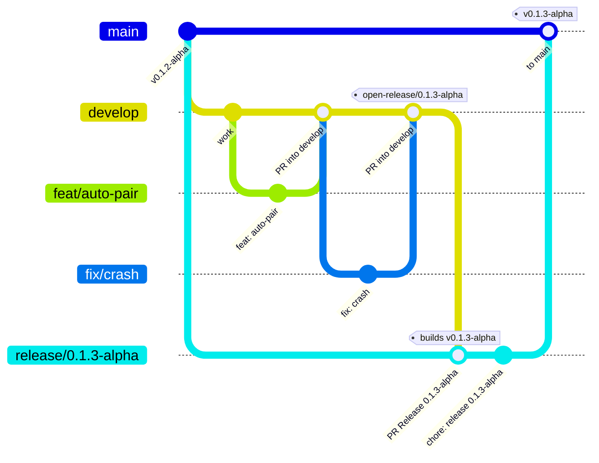
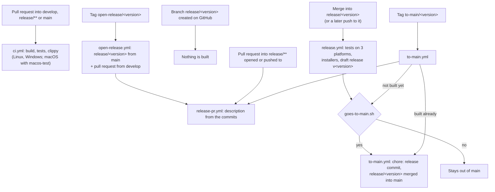

# Branches, tags and releases

How a change travels from a feature branch to an installer and to `main`, which tags steer it and what
GitHub Actions does at each step. The workflows are in [`.github/workflows`](../.github/workflows) and
the rules they share in [`.github/scripts`](../.github/scripts).

## Branches

| Branch | Comes from | Goes into | What it is |
|---|---|---|---|
| `feat/<name>`, `fix/<name>`… | `develop` | `develop` (pull request) | One change. |
| `develop` | — | `release/<version>` (pull request) | The next release, always buildable. |
| `release/<version>` | `main` | `main` (automatic) | One version being built: its name is the version. |
| `staging` | — | (pull requests only) | QA: tests a release before it reaches `main`. Its tag `to-main/<version>` takes that version to `main`. |
| `main` | — | (source of every `release/<version>`) | The released versions. Only `to-main.yml` writes to it. |

A version is `X.Y.Z` (final) or `X.Y.Z-<pre>`: `-alpha.N`, `-beta.N`, `-rc.N`. More parts may follow
`X.Y.Z` (`0.1.3.1-alpha`, `0.1.3.1.hotfix`): installers, tags and the release keep that name, while
`Cargo.toml`, which takes three numbers only, gets them as build metadata (`0.1.3-alpha+1`; the About
dialog and the `.deb` / `.rpm` show that one). [`version.sh`](../.github/scripts/version.sh) checks and
converts them.

## The whole flow



1. **Work on a branch from `develop`** (`feat/<name>`, `fix/<name>`) and open a pull request into
   `develop`. CI (`ci.yml`) builds, tests and runs clippy on Linux and Windows for every pull request into
   `develop`, `release/**` or `main`. *(TODO: SonarQube analysis, a commented job in `ci.yml`.)*
2. **Open the release** when `develop` has what the version needs, in one of two ways:
   - push a tag `open-release/<version>` (on `develop`): `open-release.yml` creates `release/<version>`
     from `main` and opens the pull request `develop` → `release/<version>`;
   - or, on GitHub, create the branch `release/<version>` from `main` and open that pull request yourself.

   Creating the branch builds nothing: only its pull request's merge (or a later push) does.
3. **Review the pull request.** `release-pr.yml` writes its description from the commits and the pull
   requests merged into `develop`: the version, whether it goes to `main`, every pull request with its
   description and every commit grouped by type (`feat`, `fix`, `ci`…) with its details. It is rewritten
   on every push to `develop` while the pull request is open. Write your own notes **outside** the
   markers `<!-- auto:start -->` / `<!-- auto:end -->`: they are kept.
4. **Merge it.** `release.yml` runs the tests on Linux, Windows and macOS, builds every installer and
   uploads them to a **draft** GitHub Release `v<version>`. Pushing again to `release/<version>` (a fix
   merged into it) rebuilds and replaces the files.
5. **To `main`.** When every installer is uploaded and the version goes to `main` (below), `to-main.yml`
   commits the version to `Cargo.toml` (`chore: release <version>`), merges `release/<version>` into
   `main` and pushes it, without a pull request: nothing else can write to `main` (see Rulesets).
   `develop` never goes into `main`. A build that fails never reaches `main`.
6. **Publish** the draft release by hand on GitHub (Releases), which creates the tag `v<version>`.

*(TODO: merge `main` back into `develop` after a release, so the `chore: release` commits of
`Cargo.toml` do not conflict in the next pull request from `develop`.)*

## Which versions go to `main`

[`goes-to-main.sh`](../.github/scripts/goes-to-main.sh) decides, for the release build and for the pull
request's description:

| Version | Goes to `main` |
|---|---|
| Final (`0.2.0`, `0.2.0.1`) | Yes, always |
| Release candidate, alpha, beta (`0.2.0-rc.1`, `0.2.0-alpha.1`, `0.2.0-beta.2`) | Only with a tag `to-main/<version>` or `main/<version>` |

## Tags

| Tag | Push it on | What it does |
|---|---|---|
| `open-release/<version>` | `develop` | Creates `release/<version>` from `main` and the pull request from `develop` into it. |
| `to-main/<version>` (or `main/<version>`) | `develop`, `staging` or `release/<version>` | Takes that version to `main`, whatever its kind. Any time: before the pull request, while it is open (its description then says *main*), before the build (merged when it ends) or after it (merged at once). |
| `macos-test` (or `macos-test-<anything>`) | the commit pushed | Adds macOS to that push's CI run. Push the branch and the tag together. |
| `v<version>` | — | Made by GitHub when the draft release is published. Do not push it. |

```bash
git tag open-release/0.1.3-alpha develop && git push origin open-release/0.1.3-alpha
```

```bash
git tag to-main/0.1.3-alpha develop && git push origin to-main/0.1.3-alpha
```

```bash
git tag -f macos-test && git push --atomic -f origin develop macos-test
```

## What runs when



## Rulesets

Settings → Rules → Rulesets on GitHub:

| Ruleset | Branches | Rules | Bypass |
|---|---|---|---|
| Pull requests | `develop`, `staging` | Pull request (0 approvals), checks `test (ubuntu-22.04)` and `test (windows-latest)`, no force push, no deletion | Nobody |
| Release branches | `release/**` | Pull request (0 approvals), no force push, no deletion | The release identity (`to-main.yml` commits `chore: release` there) |
| Main | `main` | No updates at all, no force push, no deletion | The release identity only |

No status checks on `main` or `release/**`: the `chore: release` commit is `[skip ci]`, and `release.yml`
runs the tests before it builds. Branch creation stays open (`open-release.yml` creates the branches).

**The release identity** is a GitHub App installed on this repository only (permissions: Contents and
Workflows, read and write), so that nobody, the repository's owner included, writes to `main` by hand:
its id in the variable `RELEASE_APP_ID`, its private key in the secret `RELEASE_APP_PRIVATE_KEY`.
Without them `to-main.yml` uses `RELEASE_PUSH_TOKEN`, whose owner must then be the bypass instead.

## Secrets

- `RELEASE_APP_PRIVATE_KEY` (and the variable `RELEASE_APP_ID`): the release identity, above.
- `RELEASE_PUSH_TOKEN`: a token that can write contents, pull requests and workflows (the default
  token cannot create pull requests nor change workflow files in `main`, and its pushes start no workflow).
  `open-release.yml` and `release-pr.yml` use it; `to-main.yml` only without the App.
- `GPG_PRIVATE_KEY`, `GPG_PASSPHRASE`: the release key, see [Code signing policy](code-signing.md).
- *(TODO)* `SONAR_TOKEN`, `SONAR_HOST_URL` for SonarQube.
